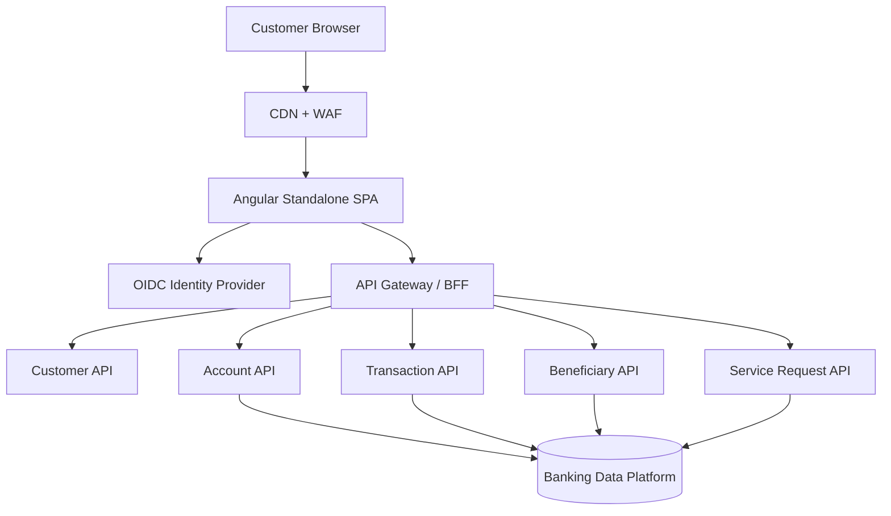

# Digital Banking Portal — Architecture

## Logical architecture

## Frontend responsibilities

- Render customer journeys and accessible UI.
- Validate input for usability; backend validates again.
- Manage temporary UI and feature state.
- Call typed APIs and handle loading/error/empty states.
- Mask sensitive values and avoid unnecessary data retention.

## Backend responsibilities

- Authentication and authorization enforcement.
- Account ownership and entitlements.
- Balance calculation and transaction correctness.
- Beneficiary cooling-off and verification policies.
- Service request workflow and audit trail.
- Rate limiting, fraud checks, and idempotency.

## State ownership

- Component state: open dialogs, selected filters.
- Feature state: current account/transaction view.
- Server state: accounts, transactions, beneficiaries.
- Do not duplicate server data into multiple global stores without a clear invalidation strategy.

## Key NFRs

| Area | Design consideration |
|---|---|
| Security | OIDC, backend authorization, CSP, masking, audit |
| Performance | CDN, lazy routes, paging, bounded payloads |
| Availability | API health, graceful errors, recoverable journeys |
| Accessibility | Keyboard support, labels, contrast, semantic tables |
| Reliability | Explicit states, safe retry policy, idempotent commands |
| Privacy | Minimize data, avoid sensitive browser persistence |
