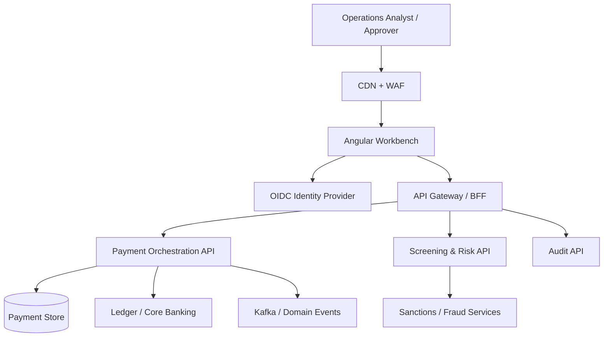

# Payment Operations Workbench — Architecture

## Frontend modules
- Dashboard: operational metrics and queue summary.
- Payments: search, filter, detail, review, and decisions.
- Create payment: validated payment instruction form.
- Shared shell: navigation and demo operator selector.
- Data access: typed API boundary, replaceable demo adapter.

## Backend owns
Payment state machine, user entitlements, segregation of duties, payment limits, beneficiary validation, screening, idempotency, ledger posting, audit persistence, and event publication.

## NFRs
- Security: OIDC, least privilege, server-side authorization, CSP.
- Reliability: idempotent commands, bounded retries, explicit state.
- Performance: server-side paging, indexed search, bounded payloads.
- Auditability: actor, timestamp, action, reason, correlation ID.
- Availability: graceful degradation and clear stale-data indicators.
